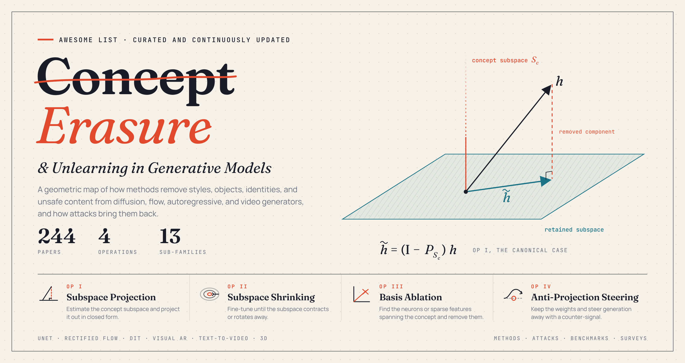

<div align="center">



[](https://awesome.re)
[](#content)
[](#)
[](#-contributing)

</div>

**Awesome Concept Erasure** provides a comprehensive and continuously updated collection of research on concept erasure and unlearning in generative models.

Concept erasure is the task of modifying a pretrained generative model so that it no longer produces a target concept, such as nudity, an artistic style, a person's identity, a copyrighted character, or a motion, while preserving its ability to generate everything else. An erasure method takes as input a pretrained generator (for example, a text-to-image diffusion model) and a specification of the target concept (usually a text prompt, sometimes example images), and outputs an edited model or an inference-time mechanism. It is evaluated on two sides: the target concept should no longer appear, even under paraphrased, multimodal, or adversarial prompts, and unrelated concepts should be generated as well as before. Concept erasure serves safety, copyright protection, privacy, and regulatory compliance, and it also serves as a probe of how concepts are represented inside generative models.

Early work suppressed unsafe content at inference time, as in [Safe Latent Diffusion [Patrick Schramowski et al., '23]](https://arxiv.org/abs/2211.05105). The task of removing a concept from the model weights was then introduced in [Erasing Concepts from Diffusion Models [Rohit Gandikota et al., '23]](https://arxiv.org/abs/2303.07345), which fine-tunes the model against its own negatively guided predictions, and concurrently in [Ablating Concepts in Text-to-Image Diffusion Models [Nupur Kumari et al., '23]](https://arxiv.org/abs/2303.13516), which maps the target concept to an anchor concept. [Unified Concept Editing [Rohit Gandikota et al., '24]](https://arxiv.org/abs/2308.14761) showed that many concepts can be erased at once with a closed-form edit of the cross-attention projections. Soon after, [Circumventing Concept Erasure Methods [Minh Pham et al., '24]](https://arxiv.org/abs/2308.01508) and [Ring-A-Bell [Yu-Lin Tsai et al., '24]](https://arxiv.org/abs/2310.10012) showed that erased concepts can often be recovered, which opened a parallel line of work on attacks and robust erasure.

In recent years (2024 to now), concept erasure has attracted rapidly growing attention. Methods have moved beyond UNet diffusion to rectified flow transformers, autoregressive image generators, and text-to-video models; benchmarks now measure erasure depth and side effects on non-target concepts; and the boundary with machine unlearning in vision-language and language models has become an active area. More papers appear every month. In this repository, erasure methods are organized by a geometric taxonomy that views each method as an operation on the subspace that a concept occupies inside the generator.

This project is curated and maintained by [Ping Liu](https://pinglmlcv.github.io/pingliu264/) ([University of Nevada, Reno](https://www.unr.edu/cse)). If you believe additional works should be included, please email <pingl@unr.edu> or [raise an issue](../../issues). Your suggestions are invaluable to keeping this resource complete and accurate.

## News

- **[2026.10]** 🎉 Repository created with **244 papers**, organized by a geometric taxonomy of concept erasure.

## Content

---

- [Geometric Taxonomy of Concept Erasure](#geometric-taxonomy-of-concept-erasure)
  - [Op I: Concept Subspace Projection](#op-i-concept-subspace-projection)
    - [Parameter Space](#parameter-space)
    - [Feature Space](#feature-space)
    - [Update Space](#update-space)
  - [Op II: Gradient-Driven Subspace Shrinking](#op-ii-gradient-driven-subspace-shrinking)
    - [Subspace Rotation](#subspace-rotation)
    - [Anchor Guidance](#anchor-guidance)
    - [Energy Compression](#energy-compression)
    - [Boundary Sharpening](#boundary-sharpening)
    - [Topology-Constrained Shrinking](#topology-constrained-shrinking)
  - [Op III: Structured Basis Ablation](#op-iii-structured-basis-ablation)
    - [Sparse Feature Decomposition](#sparse-feature-decomposition)
    - [Neuron Pruning and Parameter Subtraction](#neuron-pruning-and-parameter-subtraction)
  - [Op IV: Anti-Projection Steering](#op-iv-anti-projection-steering)
    - [Learned Adapters](#learned-adapters)
    - [Inference-Time Steering](#inference-time-steering)
    - [Gated Control](#gated-control)
  - [Reward-Driven Erasure](#reward-driven-erasure)
- [Erasure Beyond UNet Diffusion](#erasure-beyond-unet-diffusion)
  - [Flow Matching and Diffusion Transformers](#flow-matching-and-diffusion-transformers)
  - [Autoregressive Image Generators](#autoregressive-image-generators)
  - [Video Generators](#video-generators)
  - [3D Generation and Editing](#3d-generation-and-editing)
- [Continual and Compositional Erasure](#continual-and-compositional-erasure)
- [Safety Filtering and Other Settings](#safety-filtering-and-other-settings)
- [Benchmarks and Evaluation](#benchmarks-and-evaluation)
  - [Benchmarks](#benchmarks)
  - [Evaluation Studies](#evaluation-studies)
- [Attacks and Concept Reactivation](#attacks-and-concept-reactivation)
  - [White-box Attacks](#white-box-attacks)
  - [Black-box Attacks](#black-box-attacks)
  - [Multimodal and Text-free Attacks](#multimodal-and-text-free-attacks)
  - [Backdoor Attacks](#backdoor-attacks)
- [Concept Localization and Interpretability](#concept-localization-and-interpretability)
- [Unlearning in Other Model Families](#unlearning-in-other-model-families)
  - [Vision-Language and Multimodal LLMs](#vision-language-and-multimodal-llms)
  - [Large Language Models](#large-language-models)
  - [General Machine Unlearning](#general-machine-unlearning)
- [Contributing](#-contributing)
- [Relevant Surveys](#relevant-surveys)
- [Star History](#star-history)

---

## Geometric Taxonomy of Concept Erasure

### Op I: Concept Subspace Projection


#### Parameter Space

-  🔥 **Orthogonal Concept Erasure for Diffusion Models** (Yuhao Sun, Lingyun Yu, Haoxiang Xu, Fengyuan Miao, Zhuoer Xu, Hongtao Xie) · [📄 Paper](https://arxiv.org/abs/2605.28902)
-  🔥 **Erasing Thousands of Concepts: Towards Scalable and Practical Concept Erasure for Text-to-Image Diffusion Models** (Hoigi Seo, Byung Hyun Lee, Jaehyun Cho, Sungjin Lim, Se Young Chun) · [📄 Paper](https://arxiv.org/abs/2604.16481)
-  🔥 **Closed-Form Concept Erasure via Double Projections** (Chi Zhang, Jingpu Cheng, Zhixian Wang, Ping Liu) · [📄 Paper](https://arxiv.org/abs/2604.10032)
-  **CURE: Concept Unlearning via Orthogonal Representation Editing in Diffusion Models** (Shristi Das Biswas, Arani Roy, Kaushik Roy) · [📄 Paper](https://arxiv.org/abs/2505.12677)
-  **RealEra: Semantic-level Concept Erasure via Neighbor-Concept Mining** (Yufan Liu, Jinyang An, Wanqian Zhang, Ming Li, Dayan Wu, Jingzi Gu, Zheng Lin, Weiping Wang) · [📄 Paper](https://arxiv.org/abs/2410.09140)
-  **Reliable and Efficient Concept Erasure of Text-to-Image Diffusion Models** (Chao Gong, Kai Chen, Zhipeng Wei, Jingjing Chen, Yu-Gang Jiang) · [📄 Paper](https://arxiv.org/abs/2407.12383) · [💻 Code](https://github.com/CharlesGong12/RECE)
-  **MACE: Mass Concept Erasure in Diffusion Models** (Shilin Lu, Zilan Wang, Leyang Li, Yanzhu Liu, Adams Wai-Kin Kong) · [📄 Paper](https://arxiv.org/abs/2403.06135) · [💻 Code](https://github.com/Shilin-LU/MACE)
-  **Unified Concept Editing in Diffusion Models** (Rohit Gandikota, Hadas Orgad, Yonatan Belinkov, Joanna Materzyńska, David Bau) · [📄 Paper](https://arxiv.org/abs/2308.14761) · [💻 Code](https://github.com/rohitgandikota/unified-concept-editing)

#### Feature Space

-  🔥 **Uni-AdaVD: Universal Concept Erasure for Visual Generation via Orthogonal Value Decomposition** (Qifan Zhou, Yuan Wang, Yanbin Hao, Xiang Wang, Kuien Liu, Richang Hong, Meng Wang) · [📄 Paper](https://arxiv.org/abs/2607.14521)
-  🔥 **Concept Unlearning via Cross-Attention Activation Projection for Diffusion Models** (Saemi Moon, Suhyeon Jun, Seoyeon Lee, Dongwoo Kim) · [📄 Paper](https://arxiv.org/abs/2605.25765)
-  🔥 **OrthoEraser: Coupled-Neuron Orthogonal Projection for Concept Erasure** (Chuancheng Shi, Wenhua Wu, Fei Shen, Xiaogang Zhu, Kun Hu, Zhiyong Wang) · [📄 Paper](https://arxiv.org/abs/2603.11493)
-  🔥 **Localized Concept Erasure in Text-to-Image Diffusion Models via High-Level Representation Misdirection** (Uichan Lee, Jeonghyeon Kim, Sangheum Hwang) · [📄 Paper](https://arxiv.org/abs/2602.19631)
-  **Semantic Surgery: Zero-Shot Concept Erasure in Diffusion Models** (Lexiang Xiong, Chengyu Liu, Jingwen Ye, Yan Liu, Yuecong Xu) · [📄 Paper](https://arxiv.org/abs/2510.22851) · [💻 Code](https://github.com/Lexiang-Xiong/Semantic-Surgery)
-  **The Linear Geometry of Interpretable Tokens: Jailbreaking Attacks and Defenses for Unlearned Diffusion Models** (Siyi Chen, Yimeng Zhang, Sijia Liu, Qing Qu) · [📄 Paper](https://arxiv.org/abs/2504.21307)
-  **Safe and Reliable Diffusion Models via Subspace Projection** (Huiqiang Chen, Tianqing Zhu, Linlin Wang, Xin Yu, Longxiang Gao, Wanlei Zhou) · [📄 Paper](https://arxiv.org/abs/2503.16835)
-  **Localized Concept Erasure for Text-to-Image Diffusion Models Using Training-Free Gated Low-Rank Adaptation** (Byung Hyun Lee, Sungjin Lim, Se Young Chun) · [📄 Paper](https://arxiv.org/abs/2503.12356) · [💻 Code](https://github.com/Hyun1A/GLoCE)
-  **Sparse Autoencoder as a Zero-Shot Classifier for Concept Erasing in Text-to-Image Diffusion Models** (Zhihua Tian, Sirun Nan, Ming Xu, Shengfang Zhai, Wenjie Qu, Jian Liu, Ruoxi Jia, Jiaheng Zhang) · [📄 Paper](https://arxiv.org/abs/2503.09446) · [💻 Code](https://github.com/NANSirun/Interpret-then-deactivate)
-  **TRCE: Towards Reliable Malicious Concept Erasure in Text-to-Image Diffusion Models** (Ruidong Chen, Honglin Guo, Lanjun Wang, Chenyu Zhang, Weizhi Nie, An-An Liu) · [📄 Paper](https://arxiv.org/abs/2503.07389) · [💻 Code](https://github.com/ddgoodgood/TRCE)
-  **Concept Steerers: Leveraging K-Sparse Autoencoders for Test-Time Controllable Generations** (Dahye Kim, Deepti Ghadiyaram) · [📄 Paper](https://arxiv.org/abs/2501.19066)
-  **SAeUron: Interpretable Concept Unlearning in Diffusion Models with Sparse Autoencoders** (Bartosz Cywiński, Kamil Deja) · [📄 Paper](https://arxiv.org/abs/2501.18052)
-  **CE-SDWV: Effective and Efficient Concept Erasure for Text-to-Image Diffusion Models via a Semantic-Driven Word Vocabulary** (Jiahang Tu, Qian Feng, Jiahua Dong, Hanbin Zhao, Chao Zhang, Nicu Sebe, Hui Qian) · [📄 Paper](https://arxiv.org/abs/2501.15562) · [💻 Code](https://github.com/TtuHamg/CE-SDWV)
-  **Precise, Fast, and Low-cost Concept Erasure in Value Space: Orthogonal Complement Matters** (Yuan Wang, Ouxiang Li, Tingting Mu, Yanbin Hao, Kuien Liu, Xiang Wang, Xiangnan He) · [📄 Paper](https://arxiv.org/abs/2412.06143)
-  **Get What You Want, Not What You Don't: Image Content Suppression for Text-to-Image Diffusion Models** (Senmao Li, Joost van de Weijer, Taihang Hu, Fahad Shahbaz Khan, Qibin Hou, Yaxing Wang, Jian Yang) · [📄 Paper](https://arxiv.org/abs/2402.05375) · [💻 Code](https://github.com/sen-mao/SuppressEOT)

#### Update Space

-  🔥 **Now You See It, Now You Don't: Instant Concept Erasure for Safe Text-to-Image and Video Generation** (Shristi Das Biswas, Arani Roy, Kaushik Roy) · [📄 Paper](https://arxiv.org/abs/2511.18684)
-  🔥 **SPEED: Scalable, Precise, and Efficient Concept Erasure for Diffusion Models** (Ouxiang Li, Yuan Wang, Xinting Hu, Houcheng Jiang, Yanbin Hao, Fuli Feng) · [📄 Paper](https://arxiv.org/abs/2503.07392) · [💻 Code](https://github.com/Ouxiang-Li/SPEED)

### Op II: Gradient-Driven Subspace Shrinking


#### Subspace Rotation

-  🔥 **Beyond Text Prompts: Precise Concept Erasure through Text-Image Collaboration** (Jun Li, Lizhi Xiong, Ziqiang Li, Weiwei Jiang, Zhangjie Fu, Yong Li, Guo-Sen Xie) · [📄 Paper](https://arxiv.org/abs/2604.15829)
-  🔥 **Selective Fine-Tuning for Targeted and Robust Concept Unlearning** (Mansi, Avinash Kori, Francesca Toni, Soteris Demetriou) · [📄 Paper](https://arxiv.org/abs/2602.07919)
-  🔥 **Concept Unlearning by Modeling Key Steps of Diffusion Process** (Chaoshuo Zhang, Chenhao Lin, Zhengyu Zhao, Le Yang, Qian Wang, Chao Shen) · [📄 Paper](https://arxiv.org/abs/2507.06526)
-  **One Image is Worth a Thousand Words: A Usability Preservable Text-Image Collaborative Erasing Framework** (Feiran Li, Qianqian Xu, Shilong Bao, Zhiyong Yang, Xiaochun Cao, Qingming Huang) · [📄 Paper](https://arxiv.org/abs/2505.11131)
-  **CRCE: Coreference-Retention Concept Erasure in Text-to-Image Diffusion Models** (Yuyang Xue, Edward Moroshko, Feng Chen, Jingyu Sun, Steven McDonagh, Sotirios A. Tsaftaris) · [📄 Paper](https://arxiv.org/abs/2503.14232)
-  **Data Unlearning in Diffusion Models** (Silas Alberti, Kenan Hasanaliyev, Manav Shah, Stefano Ermon) · [📄 Paper](https://arxiv.org/abs/2503.01034) · [💻 Code](https://github.com/claserken/SISS)
-  **Efficient Fine-Tuning and Concept Suppression for Pruned Diffusion Models** (Reza Shirkavand, Peiran Yu, Shangqian Gao, Gowthami Somepalli, Tom Goldstein, Heng Huang) · [📄 Paper](https://arxiv.org/abs/2412.15341)
-  **Continuous Concepts Removal in Text-to-image Diffusion Models** (Tingxu Han, Weisong Sun, Yanrong Hu, Chunrong Fang, Yonglong Zhang, Shiqing Ma, Tao Zheng, Zhenyu Chen, Zhenting Wang) · [📄 Paper](https://arxiv.org/abs/2412.00580)
-  **Score Forgetting Distillation: A Swift, Data-Free Method for Machine Unlearning in Diffusion Models** (Tianqi Chen, Shujian Zhang, Mingyuan Zhou) · [📄 Paper](https://arxiv.org/abs/2409.11219) · [💻 Code](https://github.com/tqch/score-forgetting-distillation)
-  **Dark Miner: Defend against Undesirable Generation for Text-to-Image Diffusion Models** (Zheling Meng, Bo Peng, Xiaochuan Jin, Yue Jiang, Wei Wang, Jing Dong, Tieniu Tan) · [📄 Paper](https://arxiv.org/abs/2409.17682)
-  **Erasing Concepts from Diffusion Models** (Rohit Gandikota, Joanna Materzynska, Jaden Fiotto-Kaufman, David Bau) · [📄 Paper](https://arxiv.org/abs/2303.07345) · [💻 Code](https://github.com/rohitgandikota/erasing)

#### Anchor Guidance

-  🔥 **VisualErase: Dual-Branch Visual Trajectory Redirection for Robust Concept Erasure in Text-to-Image Diffusion Models** (Qianlong Xiang, Miao Zhang, Kun Wang, Yupeng Hu, Junhui Hou, Liqiang Nie) · [📄 Paper](https://arxiv.org/abs/2610.05000)
-  🔥 **AutoAnchor: Stable Diffusion Unlearning Using Cross-Attention as a Manifold Surrogate** (Siyuan Wen, Jiahao Zeng, Ningning Ding) · [📄 Paper](https://arxiv.org/abs/2607.08337)
-  **Bi-Erasing: A Bidirectional Framework for Concept Removal in Diffusion Models** (Hao Chen, Yiwei Wang, Songze Li) · [📄 Paper](https://arxiv.org/abs/2512.13039)
-  **EraseFlow: Learning Concept Erasure Policies via GFlowNet-Driven Alignment** (Abhiram Kusumba, Maitreya Patel, Kyle Min, Changhoon Kim, Chitta Baral, Yezhou Yang) · [📄 Paper](https://arxiv.org/abs/2511.00804)
-  **STEREO: A Two-Stage Framework for Adversarially Robust Concept Erasing from Text-to-Image Diffusion Models** (Koushik Srivatsan, Fahad Shamshad, Muzammal Naseer, Karthik Nandakumar) · [📄 Paper](https://arxiv.org/abs/2408.16807) · [💻 Code](https://github.com/koushiksrivats/robust-concept-erasing)
-  **Unlearning Concepts in Diffusion Model via Concept Domain Correction and Concept Preserving Gradient** (Yongliang Wu, Shiji Zhou, Mingzhuo Yang, Lianzhe Wang, Heng Chang, Wenbo Zhu, Xinting Hu, Xiao Zhou, Xu Yang) · [📄 Paper](https://arxiv.org/abs/2405.15304)
-  **AdvAnchor: Enhancing Diffusion Model Unlearning with Adversarial Anchors** (Mengnan Zhao, Lihe Zhang, Xingyi Yang, Tianhang Zheng, Baocai Yin) · [📄 Paper](https://arxiv.org/abs/2501.00054)
-  **Erasing Concepts from Text-to-Image Diffusion Models with Few-shot Unlearning** (Masane Fuchi, Tomohiro Takagi) · [📄 Paper](https://arxiv.org/abs/2405.07288) · [💻 Code](https://github.com/fmp453/few-shot-erasing)
-  **Choose Your Anchor Wisely: Effective Unlearning Diffusion Models via Concept Reconditioning** (Jingyu Zhu, Ruiqi Zhang, Licong Lin, Song Mei) · [📄 Paper](https://openreview.net/forum?id=8naq3XyGQe)
-  **Ablating Concepts in Text-to-Image Diffusion Models** (Nupur Kumari, Bingliang Zhang, Sheng-Yu Wang, Eli Shechtman, Richard Zhang, Jun-Yan Zhu) · [📄 Paper](https://arxiv.org/abs/2303.13516) · [💻 Code](https://github.com/nupurkmr9/concept-ablation)

#### Energy Compression

-  **Continual Unlearning for Foundational Text-to-Image Models without Generalization Erosion** (Kartik Thakral, Tamar Glaser, Tal Hassner, Mayank Vatsa, Richa Singh) · [📄 Paper](https://arxiv.org/abs/2503.13769)
-  **Growth Inhibitors for Suppressing Inappropriate Image Concepts in Diffusion Models** (Die Chen, Zhiwen Li, Mingyuan Fan, Cen Chen, Wenmeng Zhou, Yanhao Wang, Yaliang Li) · [📄 Paper](https://arxiv.org/abs/2408.01014)
-  **SafeGen: Mitigating Sexually Explicit Content Generation in Text-to-Image Models** (Xinfeng Li, Yuchen Yang, Jiangyi Deng, Chen Yan, Yanjiao Chen, Xiaoyu Ji, Wenyuan Xu) · [📄 Paper](https://arxiv.org/abs/2404.06666)
-  **All but One: Surgical Concept Erasing with Model Preservation in Text-to-Image Diffusion Models** (Seunghoo Hong, Juhun Lee, Simon S. Woo) · [📄 Paper](https://arxiv.org/abs/2312.12807)
-  **Implicit Concept Removal of Diffusion Models** (Zhili Liu, Kai Chen, Yifan Zhang, Jianhua Han, Lanqing Hong, Hang Xu, Zhenguo Li, Dit-Yan Yeung, James Kwok) · [📄 Paper](https://arxiv.org/abs/2310.05873)
-  **Forget-Me-Not: Learning to Forget in Text-to-Image Diffusion Models** (Eric Zhang, Kai Wang, Xingqian Xu, Zhangyang Wang, Humphrey Shi) · [📄 Paper](https://arxiv.org/abs/2303.17591) · [💻 Code](https://github.com/SHI-Labs/Forget-Me-Not)

#### Boundary Sharpening

-  🔥 **TEA: Text Encoder Alignment for Robust Concept Erasure in Text-to-Image Models** (Alireza Dehghanpour Farashah, Zhuan Shi, Negar Rostamzadeh, Golnoosh Farnadi) · [📄 Paper](https://arxiv.org/abs/2608.15341)
-  **Rethinking Robust Adversarial Concept Erasure in Diffusion Models** (Qinghong Yin, Yu Tian, Heming Yang, Xiang Chen, Xianlin Zhang, Yue Ming, Xueming Li, Yue Zhang) · [📄 Paper](https://arxiv.org/abs/2510.27285)
-  **SafeText: Safe Text-to-image Models via Aligning the Text Encoder** (Yuepeng Hu, Zhengyuan Jiang, Neil Zhenqiang Gong) · [📄 Paper](https://arxiv.org/abs/2502.20623)
-  **Mitigating Sexual Content Generation via Embedding Distortion in Text-conditioned Diffusion Models** (Jaesin Ahn, Heechul Jung) · [📄 Paper](https://arxiv.org/abs/2501.18877)
-  **Meta-Unlearning on Diffusion Models: Preventing Relearning Unlearned Concepts** (Hongcheng Gao, Tianyu Pang, Chao Du, Taihang Hu, Zhijie Deng, Min Lin) · [📄 Paper](https://arxiv.org/abs/2410.12777) · [💻 Code](https://github.com/sail-sg/Meta-Unlearning)
-  **Buster: Implanting Semantic Backdoor into Text Encoder to Mitigate NSFW Content Generation** (Xin Zhao, Xiaojun Chen, Yuexin Xuan, Zhendong Zhao, Xiaojun Jia, Xinfeng Li, Xiaofeng Wang) · [📄 Paper](https://arxiv.org/abs/2412.07249)
-  **R.A.C.E.: Robust Adversarial Concept Erasure for Secure Text-to-Image Diffusion Model** (Changhoon Kim, Kyle Min, Yezhou Yang) · [📄 Paper](https://arxiv.org/abs/2405.16341)
-  **Defensive Unlearning with Adversarial Training for Robust Concept Erasure in Diffusion Models** (Yimeng Zhang, Xin Chen, Jinghan Jia, Yihua Zhang, Chongyu Fan, Jiancheng Liu, Mingyi Hong, Ke Ding, Sijia Liu) · [📄 Paper](https://arxiv.org/abs/2405.15234) · [💻 Code](https://github.com/OPTML-Group/AdvUnlearn)

#### Topology-Constrained Shrinking

-  🔥 **TILDE: TILt-based Distributional Erasure for Concept Unlearning** (Naveen George, Naoki Murata, Yuhta Takida, Konda Reddy Mopuri, Yuki Mitsufuji) · [📄 Paper](https://arxiv.org/abs/2607.06432)
-  🔥 **Erasing Without Collateral Damage: Precise Concept Removal in Diffusion Models** (Parth Upman, Nishita Jain, Shreyank N Gowda) · [📄 Paper](https://arxiv.org/abs/2607.05274)
-  🔥 **Co-occurring Associated Retained Concepts in Diffusion Unlearning** (Miso Kim, Georu Lee, Yunji Kim, Hoki Kim, Jinseong Park, Woojin Lee) · [📄 Paper](https://arxiv.org/abs/2606.24192)
-  🔥 **Neighbor-Aware Localized Concept Erasure in Text-to-Image Diffusion Models** (Zhuan Shi, Alireza Dehghanpour Farashah, Rik de Vries, Golnoosh Farnadi) · [📄 Paper](https://arxiv.org/abs/2603.25994)
-  🔥 **Consistency-Preserving Concept Erasure via Unsafe-Safe Pairing and Directional Fisher-weighted Adaptation** (Yongwoo Kim, Sungmin Cha, Hyunsoo Kim, Jaewon Lee, Donghyun Kim) · [📄 Paper](https://arxiv.org/abs/2602.05339)
-  🔥 **Mass Concept Erasure in Diffusion Models with Concept Hierarchy** (Jiahang Tu, Ye Li, Yiming Wu, Hanbin Zhao, Chao Zhang, Hui Qian) · [📄 Paper](https://arxiv.org/abs/2601.03305)
-  🔥 **GrOCE: Graph-Guided Online Concept Erasure for Text-to-Image Diffusion Models** (Ning Han, Zhenyu Ge, Feng Han, Yuhua Sun, Chengqing Li, Jingjing Chen) · [📄 Paper](https://arxiv.org/abs/2511.12968)
-  **Minimalist Concept Erasure in Generative Models** (Yang Zhang, Er Jin, Yanfei Dong, Yixuan Wu, Philip Torr, Ashkan Khakzar, Johannes Stegmaier, Kenji Kawaguchi) · [📄 Paper](https://arxiv.org/abs/2507.13386)
-  **SAGE: Exploring the Boundaries of Unsafe Concept Domain with Semantic-Augment Erasing** (Hongguang Zhu, Yunchao Wei, Mengyu Wang, Siyu Jiao, Yan Fang, Jiannan Huang, Yao Zhao) · [📄 Paper](https://arxiv.org/abs/2506.09363) · [💻 Code](https://github.com/KevinLight831/SAGE)
-  **Set You Straight: Auto-Steering Denoising Trajectories to Sidestep Unwanted Concepts** (Leyang Li, Shilin Lu, Yan Ren, Adams Wai-Kin Kong) · [📄 Paper](https://arxiv.org/abs/2504.12782) · [💻 Code](https://github.com/lileyang1210/ANT)
-  **Fine-Grained Erasure in Text-to-Image Diffusion-based Foundation Models** (Kartik Thakral, Tamar Glaser, Tal Hassner, Mayank Vatsa, Richa Singh) · [📄 Paper](https://arxiv.org/abs/2503.19783)
-  **Fantastic Targets for Concept Erasure in Diffusion Models and Where To Find Them** (Anh Bui, Trang Vu, Long Vuong, Trung Le, Paul Montague, Tamas Abraham, Junae Kim, Dinh Phung) · [📄 Paper](https://arxiv.org/abs/2501.18950) · [💻 Code](https://github.com/tuananhbui89/Adaptive-Guided-Erasure)
-  **Erasing Concept Combinations from Text-to-Image Diffusion Model** (Hongyi Nie, Quanming Yao, Yang Liu, Zhen Wang, Yatao Bian) · [📄 Paper](https://openreview.net/forum?id=OBjF5I4PWg)
-  **Erasing Undesirable Concepts in Diffusion Models with Adversarial Preservation** (Anh Bui, Long Vuong, Khanh Doan, Trung Le, Paul Montague, Tamas Abraham, Dinh Phung) · [📄 Paper](https://arxiv.org/abs/2410.15618) · [💻 Code](https://github.com/tuananhbui89/Erasing-Adversarial-Preservation)
-  **Separable Multi-Concept Erasure from Diffusion Models** (Mengnan Zhao, Lihe Zhang, Tianhang Zheng, Yuqiu Kong, Baocai Yin) · [📄 Paper](https://arxiv.org/abs/2402.05947)
-  **SalUn: Empowering Machine Unlearning via Gradient-based Weight Saliency in Both Image Classification and Generation** (Chongyu Fan, Jiancheng Liu, Yihua Zhang, Eric Wong, Dennis Wei, Sijia Liu) · [📄 Paper](https://arxiv.org/abs/2310.12508)

### Op III: Structured Basis Ablation


#### Sparse Feature Decomposition

-  🔥 **PEAK: Precise and Persistent Concept Erasure via k-Sparse Autoencoders** (Man Jiang, Ouxiang Li, Weibao Xue, Zhenhua Tang, Yuan Wang, Shuo Wang, Yanbin Hao) · [📄 Paper](https://arxiv.org/abs/2608.10985)
-  🔥 **Look But Don't Touch with Sparse Autoencoders for Unlearning in Diffusion Models** (Enrico Cassano, Riccardo Renzulli, Rayyan Ahmed, Marco Grangetto, Stephan Alaniz) · [📄 Paper](https://arxiv.org/abs/2606.31699)
-  🔥 **SAEmnesia: Erasing Concepts in Diffusion Models with Supervised Sparse Autoencoders** (Enrico Cassano, Riccardo Renzulli, Marco Nurisso, Mirko Zaffaroni, Alan Perotti, Marco Grangetto) · [📄 Paper](https://arxiv.org/abs/2509.21379)
-  **Sparse Autoencoder as a Zero-Shot Classifier for Concept Erasing in Text-to-Image Diffusion Models** (Zhihua Tian, Sirun Nan, Ming Xu, Shengfang Zhai, Wenjie Qu, Jian Liu, Ruoxi Jia, Jiaheng Zhang) · [📄 Paper](https://arxiv.org/abs/2503.09446) · [💻 Code](https://github.com/NANSirun/Interpret-then-deactivate)
-  **Concept Steerers: Leveraging K-Sparse Autoencoders for Test-Time Controllable Generations** (Dahye Kim, Deepti Ghadiyaram) · [📄 Paper](https://arxiv.org/abs/2501.19066)
-  **SAeUron: Interpretable Concept Unlearning in Diffusion Models with Sparse Autoencoders** (Bartosz Cywiński, Kamil Deja) · [📄 Paper](https://arxiv.org/abs/2501.18052)

#### Neuron Pruning and Parameter Subtraction

-  🔥 **Forget-It-All: Multi-Concept Machine Unlearning via Concept-Aware Neuron Masking** (Kaiyuan Deng, Bo Hui, Gen Li, Jie Ji, Minghai Qin, Geng Yuan, Xiaolong Ma) · [📄 Paper](https://arxiv.org/abs/2601.06163)
-  **A Single Neuron Works: Precise Concept Erasure in Text-to-Image Diffusion Models** (Qinqin He, Jiaqi Weng, Jialing Tao, Hui Xue) · [📄 Paper](https://arxiv.org/abs/2509.21008)
-  **Unveiling Concept Attribution in Diffusion Models** (Quang H. Nguyen, Hoang Phan, Khoa D. Doan) · [📄 Paper](https://arxiv.org/abs/2412.02542) · [💻 Code](https://github.com/mail-research/CAD-attribution4diffusion)
-  **ConceptPrune: Concept Editing in Diffusion Models via Skilled Neuron Pruning** (Ruchika Chavhan, Da Li, Timothy Hospedales) · [📄 Paper](https://arxiv.org/abs/2405.19237)
-  **Pruning for Robust Concept Erasing in Diffusion Models** (Tianyun Yang, Juan Cao, Chang Xu) · [📄 Paper](https://arxiv.org/abs/2405.16534)
-  **Robust Concept Erasure Using Task Vectors** (Minh Pham, Kelly O. Marshall, Chinmay Hegde, Niv Cohen) · [📄 Paper](https://arxiv.org/abs/2404.03631) · [💻 Code](https://github.com/mnpham0417/prompt-agnostic-concept-erasure)

### Op IV: Anti-Projection Steering


#### Learned Adapters

-  🔥 **HyperErase: Scale-Calibrated Hypernetwork for Multi-Concept Erasure in Text-to-Image Models** (Yi Sun, Xinhao Zhong, Zhiqi Zhang, Yimin Zhou, Junhao Li, Yuxia Qiao) · [📄 Paper](https://arxiv.org/abs/2609.31154)
-  🔥 **Gaussian Core LoRA: Distribution-Aware Dynamic Adaptation for Broad Concept Erasure** (Qinghui Gong, Xunlei Chen, Yu-Xuan Zhang, Hua Meng, Zhengchun Zhou) · [📄 Paper](https://arxiv.org/abs/2609.01433)
-  **DuMo: Dual Encoder Modulation Network for Precise Concept Erasure** (Feng Han, Kai Chen, Chao Gong, Zhipeng Wei, Jingjing Chen, Yu-Gang Jiang) · [📄 Paper](https://arxiv.org/abs/2501.01125) · [💻 Code](https://github.com/Maplebb/DuMo)
-  **AlignGuard: Scalable Safety Alignment for Text-to-Image Generation** (Runtao Liu, I Chieh Chen, Jindong Gu, Jipeng Zhang, Renjie Pi, Qifeng Chen, Philip Torr, Ashkan Khakzar, Fabio Pizzati) · [📄 Paper](https://arxiv.org/abs/2412.10493)
-  **Direct Unlearning Optimization for Robust and Safe Text-to-Image Models** (Yong-Hyun Park, Sangdoo Yun, Jin-Hwa Kim, Junho Kim, Geonhui Jang, Yonghyun Jeong, Junghyo Jo, Gayoung Lee) · [📄 Paper](https://arxiv.org/abs/2407.21035)
-  **One-Dimensional Adapter to Rule Them All: Concepts, Diffusion Models and Erasing Applications** (Mengyao Lyu, Yuhong Yang, Haiwen Hong, Hui Chen, Xuan Jin, Yuan He, Hui Xue, Jungong Han, Guiguang Ding) · [📄 Paper](https://arxiv.org/abs/2312.16145) · [💻 Code](https://github.com/Con6924/SPM)
-  **Receler: Reliable Concept Erasing of Text-to-Image Diffusion Models via Lightweight Erasers** (Chi-Pin Huang, Kai-Po Chang, Chung-Ting Tsai, Yung-Hsuan Lai, Fu-En Yang, Yu-Chiang Frank Wang) · [📄 Paper](https://arxiv.org/abs/2311.17717) · [💻 Code](https://github.com/jasper0314-huang/Receler)

#### Inference-Time Steering

-  🔥 **Test-Time Scaling for Safe Text-Guided Image Generation via Intermediate Clean Estimates** (Jinya Sakurai, Shueicheng Yan, Xun Xu) · [📄 Paper](https://arxiv.org/abs/2608.03284)
-  🔥 **Concept Removal Guidance: Evidence-Calibrated Negative Guidance for Safe Diffusion Sampling** (Yoonseok Choi, Chaeyoung Oh, Hyunjun Choi, Seokin Seo, Kee-Eung Kim) · [📄 Paper](https://arxiv.org/abs/2606.29801)
-  🔥 **DSS: Dynamic Semantic Steering for Robust Concept Erasure in Diffusion Models** (Qinghui Gong, Zhengchun Zhou, Hua Meng, Yihuai Liang, Yuxuan Zhang) · [📄 Paper](https://arxiv.org/abs/2604.16483)
-  🔥 **EGLOCE: Training-Free Energy-Guided Latent Optimization for Concept Erasure** (Junyeong Ahn, Seojin Yoon, Sungyong Baik) · [📄 Paper](https://arxiv.org/abs/2604.09405)
-  🔥 **Modular Energy Steering for Safe Text-to-Image Generation with Foundation Models** (Yaoteng Tan, Zikui Cai, M. Salman Asif) · [📄 Paper](https://arxiv.org/abs/2604.02265)
-  🔥 **Safety-Guided Flow: A Unified Framework for Negative Guidance in Safe Generation** (Mingyu Kim, Young-Heon Kim, Mijung Park) · [📄 Paper](https://arxiv.org/abs/2603.13300)
-  🔥 **Prototype-Guided Concept Erasure in Diffusion Models** (Yuze Cai, Jiahao Lu, Hongxiang Shi, Yichao Zhou, Hong Lu) · [📄 Paper](https://arxiv.org/abs/2603.08271)
-  🔥 **When Safety Collides: Resolving Multi-Category Harmful Conflicts in Text-to-Image Diffusion via Adaptive Safety Guidance** (Yongli Xiang, Ziming Hong, Zhaoqing Wang, Xiangyu Zhao, Bo Han, Tongliang Liu) · [📄 Paper](https://arxiv.org/abs/2602.20880)
-  🔥 **ActErase: A Training-Free Paradigm for Precise Concept Erasure via Activation Patching** (Yi Sun, Xinhao Zhong, Hongyan Li, Yimin Zhou, Junhao Li, Bin Chen, Xuan Wang) · [📄 Paper](https://arxiv.org/abs/2601.00267)
-  🔥 **CASteer: Cross-Attention Steering for Controllable Concept Erasure** (Tatiana Gaintseva, Andreea-Maria Oncescu, Chengcheng Ma, Ziquan Liu, Martin Benning, Gregory Slabaugh, Jiankang Deng, Ismail Elezi) · [📄 Paper](https://arxiv.org/abs/2503.09630)
-  **CGCE: Classifier-Guided Concept Erasure in Generative Models** (Viet Nguyen, Vishal M. Patel) · [📄 Paper](https://arxiv.org/abs/2511.05865)
-  **Responsible Diffusion Models via Constraining Text Embeddings within Safe Regions** (Zhiwen Li, Die Chen, Mingyuan Fan, Cen Chen, Yaliang Li, Yanhao Wang, Wenmeng Zhou) · [📄 Paper](https://arxiv.org/abs/2505.15427) · [💻 Code](https://github.com/lzws/Responsible-Diffusion)
-  **Training-Free Safe Denoisers for Safe Use of Diffusion Models** (Mingyu Kim, Dongjun Kim, Amman Yusuf, Stefano Ermon, Mijung Park) · [📄 Paper](https://arxiv.org/abs/2502.08011) · [💻 Code](https://github.com/MingyuKim87/Safe_Denoiser)
-  **PromptGuard: Soft Prompt-Guided Unsafe Content Moderation for Text-to-Image Models** (Lingzhi Yuan, Xinfeng Li, Chejian Xu, Guanhong Tao, Xiaojun Jia, Yihao Huang, Wei Dong, Yang Liu, Bo Li) · [📄 Paper](https://arxiv.org/abs/2501.03544)
-  **Growth Inhibitors for Suppressing Inappropriate Image Concepts in Diffusion Models** (Die Chen, Zhiwen Li, Mingyuan Fan, Cen Chen, Wenmeng Zhou, Yanhao Wang, Yaliang Li) · [📄 Paper](https://arxiv.org/abs/2408.01014)
-  **TraSCE: Trajectory Steering for Concept Erasure** (Anubhav Jain, Yuya Kobayashi, Takashi Shibuya, Yuhta Takida, Nasir Memon, Julian Togelius, Yuki Mitsufuji) · [📄 Paper](https://arxiv.org/abs/2412.07658)
-  **Safeguarding Text-to-Image Generation via Inference-Time Prompt-Noise Optimization** (Jiangweizhi Peng, Zhiwei Tang, Gaowen Liu, Charles Fleming, Mingyi Hong) · [📄 Paper](https://arxiv.org/abs/2412.03876)
-  **Safe Text-to-Image Generation: Simply Sanitize the Prompt Embedding** (Huming Qiu, Guanxu Chen, Mi Zhang, Xiaohan Zhang, Xiaoyu You, Min Yang) · [📄 Paper](https://arxiv.org/abs/2411.10329)
-  **Prompt Sliders for Fine-Grained Control, Editing and Erasing of Concepts in Diffusion Models** (Deepak Sridhar, Nuno Vasconcelos) · [📄 Paper](https://arxiv.org/abs/2409.16535) · [💻 Code](https://github.com/DeepakSridhar/promptsliders)
-  **Safe Latent Diffusion: Mitigating Inappropriate Degeneration in Diffusion Models** (Patrick Schramowski, Manuel Brack, Björn Deiseroth, Kristian Kersting) · [📄 Paper](https://arxiv.org/abs/2211.05105)

#### Gated Control

-  🔥 **Concept Erasure via Attention Redirection** (Amit Schechter, Rinon Gal, Ofir Kedem, Gal Chechik, Daniel Cohen-Or) · [📄 Paper](https://cvpr.thecvf.com/virtual/2026/poster/40955)
-  🔥 **MapRoute: Precise-Concept Erasing Mappers via Semantic Routing** (Sihao Li, Baixi Liang, Shuohong Xia, Yunyun Yang) · [📄 Paper](https://openaccess.thecvf.com/content/CVPR2026/html/Li_MapRoutePrecise-Concept_Erasing_Mappers_via_Semantic_Routing_CVPR_2026_paper.html) · [💻 Code](https://github.com/GG-li/MapRoute)
-  🔥 **GenErase: Generalizable and Semantically-Aware Concept Erasure in Diffusion Models** (Korada Sri Vardhana, Soma Biswas) · [📄 Paper](https://openaccess.thecvf.com/content/CVPR2026/html/Vardhana_GenErase_Generalizable_and_Semantically-Aware_Concept_Erasure_in_Diffusion_Models_CVPR_2026_paper.html)
-  🔥 **ABCDE: Agentic-Based Controlled Dynamic Erasure for Intent-Aware Safety Reasoning** (Ping Liu, Chi Zhang) · [📄 Paper](https://mlanthology.org/tmlr/2026/liu2026tmlr-abcde/)
-  **ACE: Attentional Concept Erasure in Diffusion Models** (Finn Carter) · [📄 Paper](https://arxiv.org/abs/2504.11850)
-  **Detect-and-Guide: Self-regulation of Diffusion Models for Safe Text-to-Image Generation via Guideline Token Optimization** (Feifei Li, Mi Zhang, Yiming Sun, Min Yang) · [📄 Paper](https://arxiv.org/abs/2503.15197)
-  **Localized Concept Erasure for Text-to-Image Diffusion Models Using Training-Free Gated Low-Rank Adaptation** (Byung Hyun Lee, Sungjin Lim, Se Young Chun) · [📄 Paper](https://arxiv.org/abs/2503.12356) · [💻 Code](https://github.com/Hyun1A/GLoCE)
-  **Concept Corrector: Erase Concepts on the Fly for Text-to-Image Diffusion Models** (Zheling Meng, Bo Peng, Xiaochuan Jin, Yueming Lyu, Wei Wang, Jing Dong, Tieniu Tan) · [📄 Paper](https://arxiv.org/abs/2502.16368)
-  **Concept Replacer: Replacing Sensitive Concepts in Diffusion Models via Precision Localization** (Lingyun Zhang, Yu Xie, Yanwei Fu, Ping Chen) · [📄 Paper](https://arxiv.org/abs/2412.01244)

### Reward-Driven Erasure

> Methods that cast erasure as reward optimization with reinforcement learning. They fall outside the four operations as a training paradigm rather than a geometric action.

-  🔥 **Safe Image Generation via Reinforcement Learning** (Eungyeol Han, Jong-Seok Lee) · [📄 Paper](https://arxiv.org/abs/2610.05908)
-  🔥 **ForceForget: Reinforcement Concept Removal for Enhancing Safety in Text-to-Image Models** (Dong Han, Yong Li) · [📄 Paper](https://arxiv.org/abs/2606.14351)
-  🔥 **FlowErase-RL: Rethinking Concept Erasure as Reward Optimization in Flow Matching Models** (Yi Sun, Zhiqi Zhang, Xinhao Zhong, Yimin Zhou, Shuoyang Sun, Bin Chen, Shu-Tao Xia, Ke Xu) · [📄 Paper](https://arxiv.org/abs/2605.19739)
-  🔥 **SafeDiffusion-R1: Online Reward Steering for Safe Diffusion Post-Training** (Komal Kumar, Ankan Deria, Abhishek Basu, Fahad Shamshad, Hisham Cholakkal, Karthik Nandakumar) · [📄 Paper](https://arxiv.org/abs/2605.18719)

---

## Erasure Beyond UNet Diffusion

### Flow Matching and Diffusion Transformers

-  🔥 **Semantic Steering for Controllable Generation: Tuning-Free Concept Erasure in Multimodal Diffusion Transformers** (Qiao Li, Xiaomeng Fu, Yuanshu Zhao, Qipeng Wang, Jiao Dai, Jizhong Han) · [📄 Paper](https://arxiv.org/abs/2608.12829)
-  🔥 **FlowErase-OPD: Multi-Concept Erasure via Anchored On-Policy Distillation in Flow Matching Models** (Yi Sun, Yimin Zhou, Xinhao Zhong, Zhiqi Zhang, Junhao Li, Bin Chen) · [📄 Paper](https://arxiv.org/abs/2608.07620)
-  🔥 **Concept Removal for Frontier Image Generative Models** (Aditya Kumar, Pierre Joly, Adam Dziedzic, Franziska Boenisch) · [📄 Paper](https://arxiv.org/abs/2606.25548)
-  🔥 **Unified Safe In-context Image Generation in Multimodal Diffusion Transformers via Restricting Unsafe Information Flows** (Xiang Yang, Feifei Li, Mi Zhang, Geng Hong, Xiaoyu You, Mi Wen, Min Yang) · [📄 Paper](https://arxiv.org/abs/2606.06875)
-  🔥 **GEM: Geometric Erasure by Contrastive Velocity Matching in Rectified Flows** (Jonas Henry Grebe, Tobias Braun, Anna Rohrbach, Marcus Rohrbach) · [📄 Paper](https://arxiv.org/abs/2606.00140) · [💻 Code](https://github.com/multimodal-ai-lab/GEM)
-  🔥 **MOSAIC: Compositional Multi-Concept Erasure via Vector Field Blending** (Junseok Ko, Jungwoo Kim, Jong-Seok Lee) · [📄 Paper](https://arxiv.org/abs/2605.25574)
-  🔥 **FlowErase-RL: Rethinking Concept Erasure as Reward Optimization in Flow Matching Models** (Yi Sun, Zhiqi Zhang, Xinhao Zhong, Yimin Zhou, Shuoyang Sun, Bin Chen, Shu-Tao Xia, Ke Xu) · [📄 Paper](https://arxiv.org/abs/2605.19739)
-  🔥 **What Concepts Lie Within? Detecting and Suppressing Risky Content in Diffusion Transformers** (Chenyu Zhang) · [📄 Paper](https://arxiv.org/abs/2605.10180)
-  🔥 **SafeRoPE: Risk-specific Head-wise Embedding Rotation for Safe Generation in Rectified Flow Transformers** (Xiang Yang, Feifei Li, Mi Zhang, Geng Hong, Xiaoyu You, Min Yang) · [📄 Paper](https://arxiv.org/abs/2604.01826)
-  🔥 **Z-Erase: Enabling Concept Erasure in Single-Stream Diffusion Transformers** (Nanxiang Jiang, Zhaoxin Fan, Baisen Wang, Daiheng Gao, Junhang Cheng, Jifeng Guo, Yalan Qin, Yeying Jin, Hongwei Zheng, Faguo Wu, Wenjun Wu) · [📄 Paper](https://arxiv.org/abs/2603.25074)
-  🔥 **Differential Vector Erasure: Unified Training-Free Concept Erasure for Flow Matching Models** (Zhiqi Zhang, Xinhao Zhong, Yi Sun, Shuoyang Sun, Bin Chen, Shu-Tao Xia, Xuan Wang) · [📄 Paper](https://arxiv.org/abs/2602.01089)
-  **FADE: Adversarial Concept Erasure in Flow Models** (Zixuan Fu, Yan Ren, Finn Carter, Chenyue Wang, Ze Niu, Dacheng Yu, Emily Davis, Bo Zhang) · [📄 Paper](https://arxiv.org/abs/2507.12283)
-  **EraseAnything: Enabling Concept Erasure in Rectified Flow Transformers** (Daiheng Gao, Shilin Lu, Shaw Walters, Wenbo Zhou, Jiaming Chu, Jie Zhang, Bang Zhang, Mengxi Jia, Jian Zhao, Zhaoxin Fan, Weiming Zhang) · [📄 Paper](https://arxiv.org/abs/2412.20413)

### Autoregressive Image Generators

-  🔥 **ScaleErasure: Inference-Time Minimal Intervention for Precise Concept Erasure in Next-Scale Autoregressive Image Generation** (Cong Wang, Haiyu Wu, Zhiwei Jiang, Zifeng Cheng, Fei Shen, Yafeng Yin, Qing Gu) · [📄 Paper](https://arxiv.org/abs/2606.29282)
-  🔥 **Obliviate: Erasing Concepts from Autoregressive Image Generation Models** (Hossein Shakibania, Jonas Henry Grebe, Tobias Braun, Ege Aktemur, Saleh Aslani, Mehmet Görkem Yiğit, Marcus Rohrbach) · [📄 Paper](https://arxiv.org/abs/2606.28643)
-  🔥 **Safe Autoregressive Image Generation with Iterative Self-Improving Codebooks** (Yunqi Xue, Zhijiang Li, Philip Torr, Jindong Gu) · [📄 Paper](https://arxiv.org/abs/2606.27147)
-  🔥 **Closing the Safety Gap: Surgical Concept Erasure in Visual Autoregressive Models** (Xinhao Zhong, Yimin Zhou, Zhiqi Zhang, Junhao Li, Yi Sun, Bin Chen, Shu-Tao Xia, Xuan Wang, Ke Xu) · [📄 Paper](https://arxiv.org/abs/2509.22400)
-  **VCE: Safe Autoregressive Image Generation via Visual Contrast Exploitation** (Feng Han, Chao Gong, Zhipeng Wei, Jingjing Chen, Yu-Gang Jiang) · [📄 Paper](https://arxiv.org/abs/2509.16986)
-  **EAR: Erasing Concepts from Unified Autoregressive Models** (Haipeng Fan, Shiyuan Zhang, Baohunesitu, Zihang Guo, Huaiwen Zhang) · [📄 Paper](https://arxiv.org/abs/2506.20151)

### Video Generators

-  🔥 **FADE: Frame-Aware Diffusion-Transformer-based Multi-Concept Erasure for Video Unlearning** (Yuchen Li, Kaiyuan Deng, Chaoran Feng, Zhenyu Tang, Li Yuan) · [📄 Paper](https://arxiv.org/abs/2610.03980)
-  🔥 **FOMO: Forget the Concept, Don't Miss Out on the Scene in Selective Video Unlearning** (Łukasz Rudnik, Agnieszka Polowczyk, Alicja Polowczyk, Przemysław Spurek) · [📄 Paper](https://arxiv.org/abs/2609.39605)
-  🔥 **Motion Concept Unlearning in Video Diffusion Models** (Ping Liu, Chi Zhang) · [📄 Paper](https://arxiv.org/abs/2609.36832)
-  🔥 **CleanVideo: Adaptive Concept Erasure for Text-to-Video Diffusion Models** (Junchi Liao, Hongji Li, Wenrui Zhou, Lijie Hu) · [📄 Paper](https://arxiv.org/abs/2609.20267)
-  🔥 **Inference-Time Concept Suppression and Video-Centric Evaluation for Text-to-Video Models** (Wenxuan Chen, Wenjie Feng) · [📄 Paper](https://arxiv.org/abs/2607.14194)
-  🔥 **Pulling the REINS: Training-Free Safety Alignment of Video Diffusion Models via Representation Steering** (Rohit Kundu, Arindam Dutta, Sarosij Bose, Athula Balachandran, Amit K. Roy-Chowdhury) · [📄 Paper](https://arxiv.org/abs/2606.17257)
-  🔥 **Activation Steering of Video Generation Models via Reduced-Order Linear Optimal Control** (Jihoon Hong, Alice Chan, Qiyue Dai, Julian Skifstad, Glen Chou) · [📄 Paper](https://arxiv.org/abs/2606.04775)
-  🔥 **Where Concept Erasure Should Occur: Concept-Layer Alignment in Text-to-Video Diffusion Models** (Yiwei Xie, Ping Liu, Zheng Zhang) · [📄 Paper](https://arxiv.org/abs/2605.25941)
-  🔥 **Video Unlearning via Low-Rank Refusal Vector** (Simone Facchiano, Stefano Saravalle, Matteo Migliarini, Edoardo De Matteis, Alessio Sampieri, Andrea Pilzer, Emanuele Rodolà, Indro Spinelli, Luca Franco, Fabio Galasso) · [📄 Paper](https://arxiv.org/abs/2506.07891)
-  🔥 **DOME: Drift-Adaptive On-Policy Motion Erasure in Video Diffusion Transformers** (Ping Liu, Chi Zhang, Meng Tang)
-  **ConceptGuard: Proactive Safety in Text-and-Image-to-Video Generation through Multimodal Risk Detection** (Ruize Ma, Minghong Cai, Yilei Jiang, Jiaming Han, Yi Feng, Yingshui Tan, Xiaoyong Zhu, Bo Zhang, Bo Zheng, Xiangyu Yue) · [📄 Paper](https://arxiv.org/abs/2511.18780)
-  **VideoEraser: Concept Erasure in Text-to-Video Diffusion Models** (Naen Xu, Jinghuai Zhang, Changjiang Li, Zhi Chen, Chunyi Zhou, Qingming Li, Tianyu Du, Shouling Ji) · [📄 Paper](https://arxiv.org/abs/2508.15314)
-  **T2VUnlearning: A Concept Erasing Method for Text-to-Video Diffusion Models** (Xiaoyu Ye, Songjie Cheng, Yongtao Wang, Yajiao Xiong, Yishen Li) · [📄 Paper](https://arxiv.org/abs/2505.17550) · [💻 Code](https://github.com/VDIGPKU/T2VUnlearning)
-  **SAFREE: Training-Free and Adaptive Guard for Safe Text-to-Image and Video Generation** (Jaehong Yoon, Shoubin Yu, Vaidehi Patil, Huaxiu Yao, Mohit Bansal) · [📄 Paper](https://arxiv.org/abs/2410.12761) · [💻 Code](https://github.com/jaehong31/SAFREE)
-  **Unlearning Concepts from Text-to-Video Diffusion Models** (Shiqi Liu, Yihua Tan) · [📄 Paper](https://arxiv.org/abs/2407.14209)

### 3D Generation and Editing

-  🔥 **3DEditSafe: Defending 3D Editing Pipelines from Unsafe Generation** (Nicole Meng, Zheyuan Liu, Meng Jiang, Yingjie Lao) · [📄 Paper](https://arxiv.org/abs/2605.15398)

---

## Continual and Compositional Erasure

-  🔥 **Compositional Concept Erasure in Text-to-Image Diffusion Models via Hierarchically Grounded Semantic Surgery** (Chen Dai, Ganyu Zou, Nathan Self, Kevin Piper, Ramachandra Rao Seethiraju, Karthik Shyamsunder, Chang-Tien Lu, Naren Ramakrishnan) · [📄 Paper](https://arxiv.org/abs/2610.07337)
-  🔥 **Continual Concept Erasure in Diffusion Models by Suppressing Cross-Edit Interference** (Yongliang Wu, Haori Lu, Jinqi Luo, Wei Cao, Xingyu Zhu, Yaoyao Liu) · [📄 Paper](https://arxiv.org/abs/2610.01989)
-  🔥 **MOSAIC: Compositional Multi-Concept Erasure via Vector Field Blending** (Junseok Ko, Jungwoo Kim, Jong-Seok Lee) · [📄 Paper](https://arxiv.org/abs/2605.25574)
-  🔥 **Continual Unlearning for Text-to-Image Diffusion Models: A Regularization Perspective** (Justin Lee, Zheda Mai, Jinsu Yoo, Chongyu Fan, Cheng Zhang, Wei-Lun Chao) · [📄 Paper](https://arxiv.org/abs/2511.07970)
-  **Distill, Forget, Repeat: A Framework for Continual Unlearning in Text-to-Image Diffusion Models** (Naveen George, Naoki Murata, Yuhta Takida, Konda Reddy Mopuri, Yuki Mitsufuji) · [📄 Paper](https://arxiv.org/abs/2512.02657)
-  **Continual Unlearning for Foundational Text-to-Image Models without Generalization Erosion** (Kartik Thakral, Tamar Glaser, Tal Hassner, Mayank Vatsa, Richa Singh) · [📄 Paper](https://arxiv.org/abs/2503.13769)
-  **Continuous Concepts Removal in Text-to-image Diffusion Models** (Tingxu Han, Weisong Sun, Yanrong Hu, Chunrong Fang, Yonglong Zhang, Shiqing Ma, Tao Zheng, Zhenyu Chen, Zhenting Wang) · [📄 Paper](https://arxiv.org/abs/2412.00580)
-  **Erasing Concept Combinations from Text-to-Image Diffusion Model** (Hongyi Nie, Quanming Yao, Yang Liu, Zhen Wang, Yatao Bian) · [📄 Paper](https://openreview.net/forum?id=OBjF5I4PWg)

---

## Safety Filtering and Other Settings

-  🔥 **FlowGuard: Towards Lightweight In-Generation Safety Detection for Diffusion Models via Linear Latent Decoding** (Jinghan Yang, Yihe Fan, Xudong Pan, Min Yang) · [📄 Paper](https://arxiv.org/abs/2604.07879)
-  🔥 **Unlearning the Unpromptable: Prompt-free Instance Unlearning in Diffusion Models** (Kyungryeol Lee, Kyeonghyun Lee, Seongmin Hong, Byung Hyun Lee, Se Young Chun) · [📄 Paper](https://arxiv.org/abs/2603.10445)
-  🔥 **Compensation-free Machine Unlearning in Text-to-Image Diffusion Models by Eliminating the Mutual Information** (Xinwen Cheng, Jingyuan Zhang, Zhehao Huang, Yingwen Wu, Xiaolin Huang) · [📄 Paper](https://arxiv.org/abs/2603.00992)
-  🔥 **Value-Aligned Prompt Moderation via Zero-Shot Agentic Rewriting for Safe Image Generation** (Xin Zhao, Xiaojun Chen, Bingshan Liu, Zeyao Liu, Zhendong Zhao, Xiaoyan Gu) · [📄 Paper](https://arxiv.org/abs/2511.11693)
-  **Espresso: Robust Concept Filtering in Text-to-Image Models** (Anudeep Das, Vasisht Duddu, Rui Zhang, N. Asokan) · [📄 Paper](https://arxiv.org/abs/2404.19227)

---

## Benchmarks and Evaluation

### Benchmarks

> **Erasure depth** levels: `L1` direct trigger (the target is named in the prompt), `L2` alias and paraphrase triggers, `L3` cross-modal triggers (image or embedding inputs), `L4` adversarial or relearning recovery.

| Benchmark | Venue | Erasure Depth | Concept Types | Paper | Code / Data |
|:---|:---:|:---:|:---|:---|:---:|
| **LU-500** |  | `L1` | Logos | [📄 LU-500: A Logo Benchmark for Concept Unlearning](https://arxiv.org/abs/2607.24101) | - |
| **M-ErasureBench** |  | `L3` | Multimodal (text, embedding, image) triggers | [📄 M-ErasureBench: A Comprehensive Multimodal Evaluation Benchmark for Concept Erasure in Diffusion Models](https://arxiv.org/abs/2512.22877) | - |
| **EMMA** |  | `L2` | Diverse categories, semantic metrics | [📄 EMMA: Concept Erasure Benchmark with Comprehensive Semantic Metrics and Diverse Categories](https://arxiv.org/abs/2512.17320) | [💻 Code](https://github.com/lobsterlulu/EMMA) |
| **Side Effects** |  | `L1-L2` | Hierarchical and compositional neighbors | [📄 Side Effects of Erasing Concepts from Diffusion Models](https://arxiv.org/abs/2508.15124) | - |
| **Erased or Dormant?** |  | `L4` | Reversibility under fine-tuning | [📄 Erased or Dormant? Rethinking Concept Erasure Through Reversibility](https://arxiv.org/abs/2505.16174) | - |
| **EraseEval** |  | `L1` | Object, style, NSFW | [📄 Erasing with Precision: Evaluating Specific Concept Erasure from Text-to-Image Generative Models](https://arxiv.org/abs/2502.13989) | - |
| **T2ISafety** |  | `L1` | Toxicity, fairness, privacy | [📄 T2ISafety: Benchmark for Assessing Fairness, Toxicity, and Privacy in Image Generation](https://arxiv.org/abs/2501.12612) | - |
| **EraseBench** |  | `L1` | Visually/semantically related non-targets | [📄 Erasing More Than Intended? How Concept Erasure Degrades the Generation of Non-Target Concepts](https://arxiv.org/abs/2501.09833) | - |
| **HUB** |  | `L1` | Multi-faceted (faithfulness, alignment, side effects) | [📄 Holistic Unlearning Benchmark: A Multi-Faceted Evaluation for Text-to-Image Diffusion Model Unlearning](https://arxiv.org/abs/2410.05664) | - |
| **Six-CD** |  | `L1` | NSFW, identity, object, style | [📄 Six-CD: Benchmarking Concept Removals for Text-to-image Diffusion Models](https://arxiv.org/abs/2406.14855) | - |
| **CCE** |  | `L1` | Concept combinations | [📄 Erasing Concept Combinations from Text-to-Image Diffusion Model](https://openreview.net/forum?id=OBjF5I4PWg) | - |
| **CopyrightMeter** |  | `L1` | Copyright (style, character) | [📄 CopyrightMeter: Revisiting Copyright Protection in Text-to-image Models](https://arxiv.org/abs/2411.13144) | - |
| **UnlearnCanvas** |  | `L1` | Style, object | [📄 UnlearnCanvas: Stylized Image Dataset for Enhanced Machine Unlearning Evaluation in Diffusion Models](https://arxiv.org/abs/2402.11846) | - |
| **I2P** |  | `L1` | NSFW (7 categories) | [📄 Safe Latent Diffusion: Mitigating Inappropriate Degeneration in Diffusion Models](https://arxiv.org/abs/2211.05105) | [📦 Data](https://huggingface.co/datasets/AIML-TUDA/i2p) |

### Evaluation Studies

-  **Prompt-Based Safety Guidance Is Ineffective for Unlearned Text-to-Image Diffusion Models** (Jiwoo Shin, Byeonghu Na, Mina Kang, Wonhyeok Choi, Il-Chul Moon) · [📄 Paper](https://arxiv.org/abs/2511.04834)
-  **Erased or Dormant? Rethinking Concept Erasure Through Reversibility** (Ping Liu, Chi Zhang) · [📄 Paper](https://arxiv.org/abs/2505.16174)
-  **Unlearning or Concealment? A Critical Analysis and Evaluation Metrics for Unlearning in Diffusion Models** (Aakash Sen Sharma, Niladri Sarkar, Vikram Chundawat, Ankur A Mali, Murari Mandal) · [📄 Paper](https://arxiv.org/abs/2409.05668)

---

## Attacks and Concept Reactivation

### White-box Attacks

-  🔥 **Concept Score Relearning: A Unified Cross-Architecture Attack on Concept Erasure** (Hong Xi Tae, Jiaming Zhang, Wenwen He, Xuan Wang, Wei Yang Bryan Lim) · [📄 Paper](https://arxiv.org/abs/2609.33445)
-  🔥 **Roots Beneath the Cut: Uncovering the Risk of Concept Revival in Pruning-Based Unlearning for Diffusion Models** (Ci Zhang, Zhaojun Ding, Chence Yang, Jun Liu, Xiaoming Zhai, Shaoyi Huang, Beiwen Li, Xiaolong Ma, Jin Lu, Geng Yuan) · [📄 Paper](https://arxiv.org/abs/2603.06640)
-  🔥 **The Illusion of Forgetting: Attack Unlearned Diffusion via Initial Latent Variable Optimization** (Manyi Li, Yufan Liu, Lai Jiang, Bing Li, Yuming Li, Weiming Hu) · [📄 Paper](https://arxiv.org/abs/2602.00175)
-  🔥 **LURE: Latent Space Unblocking for Multi-Concept Reawakening in Diffusion Models** (Mengyu Sun, Ziyuan Yang, Andrew Beng Jin Teoh, Junxu Liu, Haibo Hu, Yi Zhang) · [📄 Paper](https://arxiv.org/abs/2601.14330)
-  🔥 **Erased, but Not Forgotten: Erased Rectified Flow Transformers Still Remain Unsafe Under Concept Attack** (Nanxiang Jiang, Zhaoxin Fan, Enhan Kang, Daiheng Gao, Yun Zhou, Yanxia Chang, Zheng Zhu, Yeying Jin, Wenjun Wu) · [📄 Paper](https://arxiv.org/abs/2510.00635)
-  **Rethinking the Vulnerability of Concept Erasure and a New Method** (Alex D. Richardson, Kaicheng Zhang, Lucas Beerens, Dongdong Chen) · [📄 Paper](https://arxiv.org/abs/2502.17537)
-  **Memories of Forgotten Concepts** (Matan Rusanovsky, Shimon Malnick, Amir Jevnisek, Ohad Fried, Shai Avidan) · [📄 Paper](https://arxiv.org/abs/2412.00782) · [💻 Code](https://github.com/matanr/Memories_of_Forgotten_Concepts)
-  **To Generate or Not? Safety-Driven Unlearned Diffusion Models Are Still Easy To Generate Unsafe Images ... For Now** (Yimeng Zhang, Jinghan Jia, Xin Chen, Aochuan Chen, Yihua Zhang, Jiancheng Liu, Ke Ding, Sijia Liu) · [📄 Paper](https://arxiv.org/abs/2310.11868) · [💻 Code](https://github.com/OPTML-Group/Diffusion-MU-Attack)
-  **Prompting4Debugging: Red-Teaming Text-to-Image Diffusion Models by Finding Problematic Prompts** (Zhi-Yi Chin, Chieh-Ming Jiang, Ching-Chun Huang, Pin-Yu Chen, Wei-Chen Chiu) · [📄 Paper](https://arxiv.org/abs/2309.06135) · [💻 Code](https://github.com/joycenerd/P4D)
-  **Circumventing Concept Erasure Methods For Text-to-Image Generative Models** (Minh Pham, Kelly O. Marshall, Niv Cohen, Govind Mittal, Chinmay Hegde) · [📄 Paper](https://arxiv.org/abs/2308.01508)

### Black-box Attacks

-  🔥 **Stress Testing Concept Erasure with Large Language Model Agents** (Yuyang Xue, Feng Chen, Zhihua Liu, Edward Moroshko, Jingyu Sun, Steven McDonagh, Sotirios A. Tsaftaris) · [📄 Paper](https://arxiv.org/abs/2607.17890)
-  🔥 **Erased but Exploitable: Black-box Embedding-Aware Prompting Against Unlearned Text-to-Image Diffusion Models** (Arian Komaei Koma, Seyed Amir Kasaei, AmirMahdi Sadeghzadeh, Mohammad Hossein Rohban) · [📄 Paper](https://arxiv.org/abs/2605.26332)
-  🔥 **ReLAPSe: Reinforcement-Learning-trained Adversarial Prompt Search for Erased Concepts in Unlearned Diffusion Models** (Ignacy Kolton, Kacper Marzol, Paweł Batorski, Marcin Mazur, Paul Swoboda, Przemysław Spurek) · [📄 Paper](https://arxiv.org/abs/2602.00350)
-  🔥 **Jailbreaking Safeguarded Text-to-Image Models via Large Language Models** (Zhengyuan Jiang, Yuepeng Hu, Yuchen Yang, Yinzhi Cao, Neil Zhenqiang Gong) · [📄 Paper](https://arxiv.org/abs/2503.01839) · [💻 Code](https://github.com/zhengyuan-jiang/PromptTune)
-  **Metaphor-based Jailbreak Attacks on Text-to-Image Models** (Chenyu Zhang, Lanjun Wang, Yiwen Ma, Wenhui Li, Yi Tu, An-An Liu) · [📄 Paper](https://arxiv.org/abs/2512.10766)
-  **Jailbreaking Prompt Attack: A Controllable Adversarial Attack against Diffusion Models** (Jiachen Ma, Yijiang Li, Zhiqing Xiao, Anda Cao, Jie Zhang, Chao Ye, Junbo Zhao) · [📄 Paper](https://arxiv.org/abs/2404.02928)
-  **Automatic Jailbreaking of the Text-to-Image Generative AI Systems** (Minseon Kim, Hyomin Lee, Boqing Gong, Huishuai Zhang, Sung Ju Hwang) · [📄 Paper](https://arxiv.org/abs/2405.16567) · [💻 Code](https://github.com/Kim-Minseon/APGP)
-  **Probing Unlearned Diffusion Models: A Transferable Adversarial Attack Perspective** (Xiaoxuan Han, Songlin Yang, Wei Wang, Yang Li, Jing Dong) · [📄 Paper](https://arxiv.org/abs/2404.19382)
-  **Concept Arithmetics for Circumventing Concept Inhibition in Diffusion Models** (Vitali Petsiuk, Kate Saenko) · [📄 Paper](https://arxiv.org/abs/2404.13706)
-  **Ring-A-Bell! How Reliable are Concept Removal Methods for Diffusion Models?** (Yu-Lin Tsai, Chia-Yi Hsu, Chulin Xie, Chih-Hsun Lin, Jia-You Chen, Bo Li, Pin-Yu Chen, Chia-Mu Yu, Chun-Ying Huang) · [📄 Paper](https://arxiv.org/abs/2310.10012) · [💻 Code](https://github.com/chiayi-hsu/Ring-A-Bell)
-  **SneakyPrompt: Jailbreaking Text-to-image Generative Models** (Yuchen Yang, Bo Hui, Haolin Yuan, Neil Gong, Yinzhi Cao) · [📄 Paper](https://arxiv.org/abs/2305.12082) · [💻 Code](https://github.com/Yuchen413/text2image_safety)

### Multimodal and Text-free Attacks

-  🔥 **PROBE: Diagnosing Residual Concept Capacity in Erased Text-to-Video Diffusion Models** (Yiwei Xie, Zheng Zhang, Ping Liu) · [📄 Paper](https://arxiv.org/abs/2603.21547) · [💻 Code](https://github.com/YiweiXie/PRObingBasedEvaluation)
-  🔥 **TINA: Text-Free Inversion Attack for Unlearned Text-to-Image Diffusion Models** (Qianlong Xiang, Miao Zhang, Haoyu Zhang, Kun Wang, Junhui Hou, Liqiang Nie) · [📄 Paper](https://arxiv.org/abs/2603.17828)
-  🔥 **REFORGE: Multi-modal Attacks Reveal Vulnerable Concept Unlearning in Image Generation Models** (Yong Zou, Haoran Li, Fanxiao Li, Shenyang Wei, Yunyun Dong, Li Tang, Wei Zhou, Renyang Liu) · [📄 Paper](https://arxiv.org/abs/2603.16576)
-  **Unified Prompt Attack Against Text-to-Image Generation Models** (Duo Peng, Qiuhong Ke, Mark He Huang, Ping Hu, Jun Liu) · [📄 Paper](https://arxiv.org/abs/2502.16423)
-  **UPAM: Unified Prompt Attack in Text-to-Image Generation Models Against Both Textual Filters and Visual Checkers** (Duo Peng, Qiuhong Ke, Jun Liu) · [📄 Paper](https://arxiv.org/abs/2405.11336)
-  **MMA-Diffusion: MultiModal Attack on Diffusion Models** (Yijun Yang, Ruiyuan Gao, Xiaosen Wang, Tsung-Yi Ho, Nan Xu, Qiang Xu) · [📄 Paper](https://arxiv.org/abs/2311.17516) · [💻 Code](https://github.com/yangyijune/MMA-Diffusion)

### Backdoor Attacks

-  🔥 **Erased but Not Forgotten: How Backdoors Compromise Concept Erasure** (Tobias Braun, Jonas Henry Grebe, Patrick Mohr, Marcus Rohrbach, Anna Rohrbach) · [📄 Paper](https://arxiv.org/abs/2504.21072) · [💻 Code](https://github.com/multimodal-ai-lab/EEB)
-  **EvilEdit: Backdooring Text-to-Image Diffusion Models in One Second** (Hao Wang, Shangwei Guo, Jialing He, Kangjie Chen, Shudong Zhang, Tianwei Zhang, Tao Xiang)
-  **Rickrolling the Artist: Injecting Backdoors into Text Encoders for Text-to-Image Synthesis** (Lukas Struppek, Dominik Hintersdorf, Kristian Kersting) · [📄 Paper](https://arxiv.org/abs/2211.02408)

---

## Concept Localization and Interpretability

-  🔥 **Cascaded Sparse Autoencoders Learn Multi-Level Visual Concepts in Multimodal LLMs** (Yusong Zhao, Hengyi Wang, Tanuja Ganu, Akshay Nambi, Hao Wang) · [📄 Paper](https://arxiv.org/abs/2606.16193)
-  🔥 **Interpretable and Steerable Concept Bottleneck Sparse Autoencoders** (Akshay Kulkarni, Tsui-Wei Weng, Vivek Narayanaswamy, Shusen Liu, Wesam A. Sakla, Kowshik Thopalli) · [📄 Paper](https://arxiv.org/abs/2512.10805)
-  **Temporal Concept Dynamics in Diffusion Models via Prompt-Conditioned Interventions** (Ada Gorgun, Fawaz Sammani, Nikos Deligiannis, Bernt Schiele, Jonas Fischer) · [📄 Paper](https://arxiv.org/abs/2512.08486)
-  **A Geometric Unification of Concept Learning with Concept Cones** (Alexandre Rocchi, Thomas Fel, Gianni Franchi) · [📄 Paper](https://arxiv.org/abs/2512.07355)
-  **Angular Steering: Behavior Control via Rotation in Activation Space** (Hieu M. Vu, Tan M. Nguyen) · [📄 Paper](https://arxiv.org/abs/2510.26243) · [💻 Code](https://github.com/lone17/angular-steering)
-  **Localizing Knowledge in Diffusion Transformers** (Arman Zarei, Samyadeep Basu, Keivan Rezaei, Zihao Lin, Sayan Nag, Soheil Feizi) · [📄 Paper](https://arxiv.org/abs/2505.18832)
-  **On Mechanistic Knowledge Localization in Text-to-Image Generative Models** (Samyadeep Basu, Keivan Rezaei, Priyatham Kattakinda, Ryan Rossi, Cherry Zhao, Vlad Morariu, Varun Manjunatha, Soheil Feizi) · [📄 Paper](https://arxiv.org/abs/2405.01008) · [💻 Code](https://github.com/samyadeepbasu/LocoGen)
-  **Localizing and Editing Knowledge in Text-to-Image Generative Models** (Samyadeep Basu, Nanxuan Zhao, Vlad Morariu, Soheil Feizi, Varun Manjunatha) · [📄 Paper](https://arxiv.org/abs/2310.13730)
-  **Concept Bottleneck Models** (Pang Wei Koh, Thao Nguyen, Yew Siang Tang, Stephen Mussmann, Emma Pierson, Been Kim, Percy Liang) · [📄 Paper](https://arxiv.org/abs/2007.04612)

---

## Unlearning in Other Model Families

### Vision-Language and Multimodal LLMs

-  🔥 **On the Robustness of Machine Unlearning for Vision-Language Models** (Yujie Lin, Kaidi Jia, Jiayao Ma, Chengyi Yang, Jinsong Su) · [📄 Paper](https://arxiv.org/abs/2605.26992)
-  🔥 **Precise Shield: Explaining and Aligning VLLM Safety via Neuron-Level Guidance** (Enyi Shi, Fei Shen, Chuancheng Shi, Shuyi Miao, Linxia Zhu, Pengyang Shao, Jinhui Tang, Tat-Seng Chua) · [📄 Paper](https://arxiv.org/abs/2604.08881)
-  🔥 **Dictionary-Aligned Concept Control for Safeguarding Multimodal LLMs** (Jinqi Luo, Jinyu Yang, Tal Neiman, Lei Fan, Bing Yin, Son Tran, Mubarak Shah, René Vidal) · [📄 Paper](https://arxiv.org/abs/2604.08846)
-  🔥 **DSCA: Dynamic Subspace Concept Alignment for Lifelong VLM Editing** (Gyanendra Das, Sai Satyam Jena) · [📄 Paper](https://arxiv.org/abs/2604.07965)
-  🔥 **Can VLMs Truly Forget? Benchmarking Training-Free Visual Concept Unlearning** (Zhangyun Tan, Zeliang Zhang, Susan Liang, Yolo Yunlong Tang, Lisha Chen, Chenliang Xu) · [📄 Paper](https://arxiv.org/abs/2604.03114)
-  🔥 **SALMUBench: A Benchmark for Sensitive Association-Level Multimodal Unlearning** (Cai Selvas-Sala, Lei Kang, Lluis Gomez) · [📄 Paper](https://arxiv.org/abs/2603.26316)
-  🔥 **Which Concepts to Forget and How to Refuse? Decomposing Concepts for Continual Unlearning in Large Vision-Language Models** (Hyundong Jin, Dongyoon Han, Eunwoo Kim) · [📄 Paper](https://arxiv.org/abs/2603.21484)
-  🔥 **GuardAlign: Test-Time Safety Alignment in Large Vision-Language Models** (Xingyu Zhu, Beier Zhu, Junfeng Fang, Shuo Wang, Yin Zhang, Xiang Wang, Xiangnan He) · [📄 Paper](https://arxiv.org/abs/2602.24027)
-  🔥 **Unlearning without Forgetting: Securely Removing Targeted Concepts from Large-Scale Vision-Language Open-Vocabulary Detectors** (Zhongze Wu, Xiu Su, Feng Yang, Dan Niu, Shan You, Yueyi Luo, Jun Long) · [📄 Paper](https://openaccess.thecvf.com/content/CVPR2026/html/Wu_Unlearning_without_Forgetting_Securely_Removing_Targeted_Concepts_from_Large-Scale_Vision-Language_CVPR_2026_paper.html)
-  **SAUCE: Selective Concept Unlearning in Vision-Language Models with Sparse Autoencoders** (Qing Li, Jiahui Geng, Derui Zhu, Fengyu Cai, Chenyang Lyu, Fakhri Karray) · [📄 Paper](https://arxiv.org/abs/2503.14530)

### Large Language Models

-  🔥 **Who Transfers Safety? Identifying and Targeting Cross-Lingual Shared Safety Neurons** (Xianhui Zhang, Chengyu Xie, Linxia Zhu, Yonghui Yang, Weixiang Zhao, Zifeng Cheng, Cong Wang, Fei Shen, Tat-Seng Chua) · [📄 Paper](https://arxiv.org/abs/2602.01283)
-  🔥 **FIT to Forget: Robust Continual Unlearning for Large Language Models** (Xiaoyu Xu, Minxin Du, Kun Fang, Yaxin Xiao, Zhicong Huang, Cheng Hong, Qingqing Ye, Haibo Hu) · [📄 Paper](https://arxiv.org/abs/2601.21682)
-  **RULE: Reinforcement UnLEarning Achieves Forget-Retain Pareto Optimality** (Chenlong Zhang, Zhuoran Jin, Hongbang Yuan, Jiaheng Wei, Tong Zhou, Kang Liu, Jun Zhao, Yubo Chen) · [📄 Paper](https://arxiv.org/abs/2506.07171) · [💻 Code](https://github.com/chenlong-clock/RULE-Unlearn)
-  **Mechanistic Unlearning: Robust Knowledge Unlearning and Editing via Mechanistic Localization** (Phillip Guo, Aaquib Syed, Abhay Sheshadri, Aidan Ewart, Gintare Karolina Dziugaite) · [📄 Paper](https://arxiv.org/abs/2410.12949)
-  **Towards Robust and Parameter-Efficient Knowledge Unlearning for LLMs** (Sungmin Cha, Sungjun Cho, Dasol Hwang, Moontae Lee) · [📄 Paper](https://arxiv.org/abs/2408.06621)

### General Machine Unlearning

-  🔥 **Machine Unlearning under Retain-Forget Entanglement** (Jingpu Cheng, Ping Liu, Qianxiao Li, Chi Zhang) · [📄 Paper](https://arxiv.org/abs/2603.26569)
-  🔥 **Unlearning for One-Step Generative Models via Unbalanced Optimal Transport** (Hyundo Choi, Junhyeong An, Jinseong Park, Jaewoong Choi) · [📄 Paper](https://arxiv.org/abs/2603.16489)
-  🔥 **Easy to Learn, Yet Hard to Forget: Towards Robust Unlearning Under Bias** (JuneHyoung Kwon, MiHyeon Kim, Eunju Lee, Yoonji Lee, Seunghoon Lee, YoungBin Kim) · [📄 Paper](https://arxiv.org/abs/2602.21773)
-  🔥 **Benchmarking Unlearning for Vision Transformers** (Kairan Zhao, Iurie Luca, Peter Triantafillou) · [📄 Paper](https://arxiv.org/abs/2602.20114)
-  🔥 **MEGU: Machine-Guided Unlearning with Target Feature Disentanglement** (Haoyu Wang, Zhuo Huang, Xiaolong Wang, Bo Han, Zhiwei Lin, Tongliang Liu) · [📄 Paper](https://arxiv.org/abs/2602.17088)
-  🔥 **Erase at the Core: Representation Unlearning for Machine Unlearning** (Jaewon Lee, Yongwoo Kim, Donghyun Kim) · [📄 Paper](https://arxiv.org/abs/2602.05375)
-  **A Reliable Cryptographic Framework for Empirical Machine Unlearning Evaluation** (Yiwen Tu, Pingbang Hu, Jiaqi Ma) · [📄 Paper](https://arxiv.org/abs/2404.11577)
-  **SalUn: Empowering Machine Unlearning via Gradient-based Weight Saliency in Both Image Classification and Generation** (Chongyu Fan, Jiancheng Liu, Yihua Zhang, Eric Wong, Dennis Wei, Sijia Liu) · [📄 Paper](https://arxiv.org/abs/2310.12508)

---

## 🤝 Contributing

Pull requests are welcome. Please add each paper to the matching section in the format below, keeping the list in reverse chronological order:

```markdown
-  🔥 **Paper Title** · [📄 Paper](https://arxiv.org/abs/XXXX.XXXXX) · [💻 Code](https://github.com/owner/repo)
```

Badge colors:  preprint,  vision conference,  machine learning venue,  journal,  other conference,  workshop. 🔥 marks papers from 2026.

---

## Relevant Surveys

-  **Erasing Concepts, Steering Generations: A Comprehensive Survey of Concept Suppression** (Yiwei Xie, Ping Liu, Zheng Zhang) · [📄 Paper](https://arxiv.org/abs/2505.19398)
-  **A Comprehensive Survey on Concept Erasure in Text-to-Image Diffusion Models** (Changhoon Kim, Yanjun Qi) · [📄 Paper](https://arxiv.org/abs/2502.14896)
-  **Machine Unlearning: A Survey** (Heng Xu, Tianqing Zhu, Lefeng Zhang, Wanlei Zhou, Philip S. Yu) · [📄 Paper](https://arxiv.org/abs/2306.03558)

---

## Star History

<p align="center">
<a href="https://star-history.com/#pinglmlcv/Awesome-Concept-Erasure&Date">

</a>
</p>
